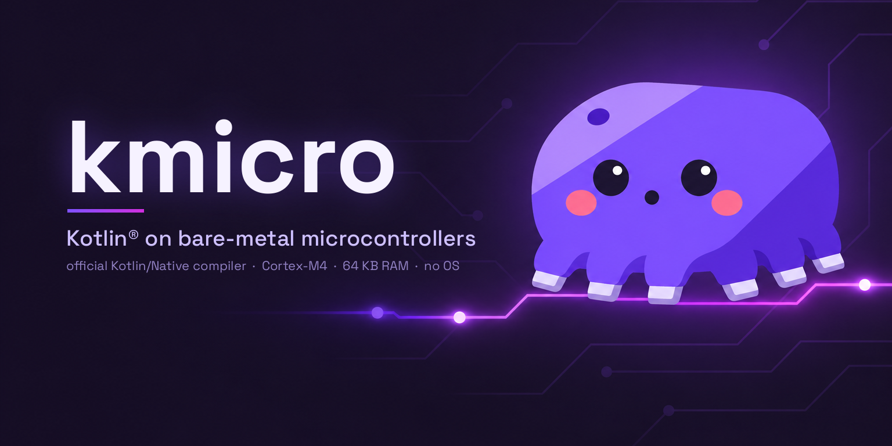

<h1 align="center">
  
</h1>

[](https://github.com/masa002/kmicro/actions/workflows/ci.yml)
[](LICENSE)
[](https://github.com/JetBrains/kotlin/releases/tag/v2.4.21)
[](docs/how-it-works.md)
[](#numbers)
[](#status)

**Running Kotlin® on bare-metal microcontrollers, built by the official compiler.**

kmicro runs the output of the unmodified Kotlin/Native 2.4.21 compiler on a Cortex-M4 with no operating system and
64 KB of RAM. It replaces the Kotlin/Native runtime with one written for a single thread and a heap of a few
kilobytes: a precise garbage collector, exceptions, coroutines, strings, and cinterop to call C.

```kotlin
// hello.kt
fun main() {
    val names = List(3) { "Kotlin #${it + 1}" }
    println("Hello from ${names.joinToString()} on a bare Cortex-M4")
}
```

```
$ python tools/kbuild.py build/hello hello.kt
$ python tools/qbuild.py build/hello/hello.elf targets/common/kotlin_main.c build/hello/k.o --run
qbuild: hello.elf  text 71228  data 80  bss 18864  stack 79812
Hello from Kotlin #1, Kotlin #2, Kotlin #3 on a bare Cortex-M4
qemu: exit 0
```

kbuild compiles the Kotlin code for the Cortex-M4; qbuild links it with the kmicro runtime and runs it on QEMU's
emulated STM32L475. [examples/hello](examples/hello) does the same from a C `main`, the way a firmware written in C
starts calling Kotlin.

## Status

kmicro is experimental. It grew out of a real device firmware ([Origin](#origin)): 24 modules written in Kotlin on
an STM32L431 with 64 KB of RAM and 256 KB of flash. That firmware is not part of this repository; the examples,
tests and the [board run of the self-test](examples/selftest/stm32l431-report.txt) are.

Most of the language and the standard library behave exactly as on stock Kotlin/Native: `tools/difftest.py` builds
the same program for the host and for kmicro and compares the output byte for byte. The full list, feature by
feature, is in [docs/kotlin-support.md](docs/kotlin-support.md).

| Works | Notes |
|---|---|
| classes, interfaces, generics, lambdas, objects, data/sealed/enum/value classes, delegation | |
| a Kotlin-only program with `fun main()`, or Kotlin functions called from a C `main` | C names through `--c-api` or `@CName` |
| garbage collection | precise mark-sweep in a fixed arena (`KM_HEAP_BYTES`), non-moving |
| strings, `StringBuilder`, `println`, `readln` | UTF-16; text goes out through your `kmicro_puts` and comes in through `kmicro_getc` |
| exceptions, `try`/`catch`/`finally`, cause chains, `runCatching`, `setUnhandledExceptionHook` | ARM EHABI unwinding; the uncaught-exception report prints the causes |
| coroutines (`kotlin.coroutines`) | suspend, resume, sequence builders, your own event loop |
| collections, sequences, `Regex`, number formatting and parsing | output byte-identical to stock Kotlin/Native; `Regex` needs a large heap (below) |
| `kotlin.random`, `kotlin.time`, `Uuid`, `Platform`, `exitProcess` | clocks and entropy come from board hooks; the QEMU targets provide the clocks |
| atomics, including the atomic arrays | atomic against interrupt handlers |
| cinterop: scalars, pointers, strings, globals, enums, structs by value, `staticCFunction` callbacks, varargs, `StableRef` | kbuild runs cinterop for you (`--def`) |
| interrupt handlers in Kotlin | they must not allocate: [docs/writing-kotlin.md](docs/writing-kotlin.md), [examples/irq](examples/irq) |

Every standard-library function that calls into the runtime is implemented, or stops the program with
"... is not supported on kmicro" where it needs threads or an OS (`python tools/missing_natives.py -v` lists them).

### Known gaps

The short list; [docs/kotlin-support.md](docs/kotlin-support.md) has every case.

- **Regex is big:** a few small patterns need a 32 KB heap and `\p{L}` about 56 KB, many patterns do not fit even
  in 64 KB, and the engine adds about 240 KB of flash, so a program using it does not fit the STM32L431. Deep backtracking over long
  input overflows the stack. `RegexOption.CANON_EQ` throws `IllegalArgumentException`.
- **Running out of memory stops the program:** heap exhaustion ends with an out-of-memory report, not a catchable
  `OutOfMemoryError` (one request larger than the whole heap does throw). Kotlin/Native puts constant-size local
  arrays on the stack; kbuild warns about those above 512 bytes.
- **Faults are not exceptions:** a stack overflow or a null-pointer read stops the program with a fault report
  (exit 99). The QEMU target `qemu-l475` catches both with the MPU; the STM32L431 example reports faults but has no
  stack guard yet.
- **Board hooks:** without them the clocks (`measureTime`, `TimeSource.Monotonic`, `Clock.System`) and
  `Uuid.random()` stop the program naming the missing hook, `Random.Default` repeats its sequence after every reset,
  and `readln()` sees the end of the input. [runtime/kmicro.h](runtime/kmicro.h) lists the hooks.
- **Stack traces:** addresses, at most 12 frames; [tools/symbolize.py](tools/symbolize.py) turns them into function
  names, with file and line when the code is built with `-g`. Functions that LTO inlines fold into their callers.
- **Smaller limits:** `kotlin.math` results are within 2 ulp of stock (newlib's libm); `nativeHeap`, `memScoped`
  and `cstr` share a 1 KB arena (`KM_INTEROP_BYTES`); a public function whose backtick name contains a space cannot
  be exported to C (make it `internal` or `private`); on Windows, a file name with characters outside the ANSI code
  page fails in the xPack tools.

Limits by design:

- **One compiler version.** kmicro reads the IR of Kotlin/Native 2.4.21. It builds on the `linux_arm32_hfp` target,
  which JetBrains has deprecated, so a later compiler may not offer it.
- **One CPU, tested: Cortex-M4F.** The compiler target is hard-float, so the core needs an FPU. The CPU is one setting,
  `TARGET_M4F` in [toolchain/paths.py](toolchain/paths.py), so a Cortex-M7 should need only that (untested); a core
  without an FPU would need the soft-float calling convention.
- **One thread.** Interrupts are fine, with the rules in [docs/writing-kotlin.md](docs/writing-kotlin.md). There are
  no threads: `Worker` and `WeakReference` are not supported.
- **The standard library only.** kotlinx libraries are untested.

## Getting started

1. Install the tools listed in [BUILDING.md](BUILDING.md): Kotlin/Native 2.4.21 and a Java runtime to run it (its
   first compile downloads LLVM), the xPack Arm GCC (for newlib and libgcc), QEMU for Arm, Python 3.10 or later.
2. `python toolchain/paths.py` shows what it found.
3. `python tests/run_all.py` builds every test and example and runs them on an emulated STM32L475, and
   `python -m unittest discover -s tests/unit` tests the tools. The first run compiles each program with
   kotlinc-native, about a minute each.

Your own program is the hello world above: kbuild takes Kotlin files or a folder of them, and `fun main()` can be in
any package (`--main` makes a missing one a build error).

**Calling C.** Name the C headers in a cinterop `.def` file. kbuild runs cinterop and also writes a `bridges.o`,
which is linked with `k.o`:

```
python tools/kbuild.py build/app app.kt --def sensor.def -I include
python tools/qbuild.py build/app/app.elf targets/common/kotlin_main.c sensor.c build/app/k.o build/app/bridges.o -I include --run
```

```kotlin
@file:OptIn(kotlinx.cinterop.ExperimentalForeignApi::class)

import sensor.*                 // sensor.def: headers = sensor.h, package = sensor

fun main() {
    val mv = List(sensor_count()) { sensor_read(it) }
    println("sensors: ${mv.joinToString { "$it mV" }}, average ${mv.average()} mV")
}
```

[tests/cinterop_shapes](tests/cinterop_shapes) shows structs by value, callbacks, globals, varargs and
static inline header functions. [examples/irq](examples/irq) uses [support/hw.def](support/hw.def) for register
access and handles SysTick in Kotlin.

**C calling Kotlin.** `--c-api app.h --package app` gives the Kotlin functions of package `app` the C names of the
prototypes in `app.h`, so a C `main` can call them after `kmicro_init()`: [examples/hello](examples/hello).

**On a real board**, link `k.o` (and `bridges.o`) with `runtime/`, your startup code and a linker script.
[docs/porting.md](docs/porting.md) explains each piece: the functions the board provides, the start-up, the
runtime's compiler flags (clang, `-fexceptions -funwind-tables`, without which `runtime/eh.c` stops the build), the
linker-script sections and the libraries. [examples/selftest/stm32l431](examples/selftest/stm32l431) does this for
an STM32L431.

## Numbers

[examples/selftest](examples/selftest) on an STM32L431 at 16 MHz, 16 KB Kotlin heap
([full report](examples/selftest/stm32l431-report.txt)):

| Check | Time |
|---|---|
| runtime start (module initializers) | 111 µs |
| classes, interface, virtual calls | 53 µs |
| garbage collection: 6000+ objects through the 16 KB heap | 161 ms |
| strings: 10 checks, UTF-16, JVM `hashCode` | 1.5 ms |
| one `throw` + `catch` | 1.6 ms\* |
| coroutine: 300 suspend/resume cycles | 49 ms |
| one full collection | 1.8 ms |

\* Measured before [#3](https://github.com/masa002/kmicro/issues/3) stopped the stack-trace walk from visiting the
same frame several times. On QEMU one throw-to-catch now takes about 6,100 instructions instead of 17,600; the board
figure will be measured again.

## Repository layout

| Folder | Contents |
|---|---|
| [runtime/](runtime) | the Kotlin runtime, in C and C++; `kmicro.h` is its contract with the board |
| [toolchain/](toolchain) | the build steps: `paths.py` finds the tools (tested versions in `versions.txt`), `kn.py` runs the pipeline, `retarget.py` and `bridges.py` adapt the compiler's IR |
| [support/](support) | `hw.h`, `hw.c`, `hw.def`: volatile register access, barriers, interrupt masks for Kotlin |
| [targets/](targets) | startup code and linker scripts for QEMU (`qemu-l475` for programs, `qemu-an386` through `qbuild --target an386` for programs that need more memory), and `common/kotlin_main.c` for `fun main()` |
| [tools/](tools) | `kbuild.py`, `qbuild.py`, `gen_regs.py` (CMSIS to Kotlin), `isr_check.py`, `symbolize.py`, `frames.py`, `missing_natives.py`, `difftest.py`, `measure.py`, `irstat.py`, `port_dtoa.py` |
| [examples/](examples) | `hello`, `irq` (a Kotlin SysTick handler on registers), `selftest` (with its STM32L431 board files) |
| [tests/](tests) | `run_all.py`, the test programs, the differential tests, `unit/` for the tools |
| [docs/](docs) | [Kotlin support](docs/kotlin-support.md), [how it works](docs/how-it-works.md), [writing Kotlin for a microcontroller](docs/writing-kotlin.md), [design notes](docs/research) |

## Origin

kmicro started inside its author's own hardware project: a board that the author, Masahiro Obara, designed and
built, with firmware the author wrote, first in C and then module by module in Kotlin (24 modules on an
STM32L431). kmicro is the runtime and toolchain that made the Kotlin part possible; it was split out of that
project and is developed on its own.

That firmware is a separate, unpublished project. It is not part of this repository, and nothing here licenses
it; it uses kmicro like any other program. `support/hw.h` and `tools/gen_regs.py` were first written for it and
are part of kmicro, under the same Apache License 2.0. kmicro and the firmware were made on the author's own time
and equipment and are not related to the author's employer.

## License

Copyright 2026 Masahiro Obara (masa002) and the kmicro contributors.

Apache License 2.0: [LICENSE](LICENSE). Parts follow Kotlin/Native and Apache Harmony sources: [NOTICE](NOTICE).

kmicro is an independent project, not affiliated with or endorsed by JetBrains or the Kotlin Foundation. "Kotlin"
refers to the Kotlin® programming language.
